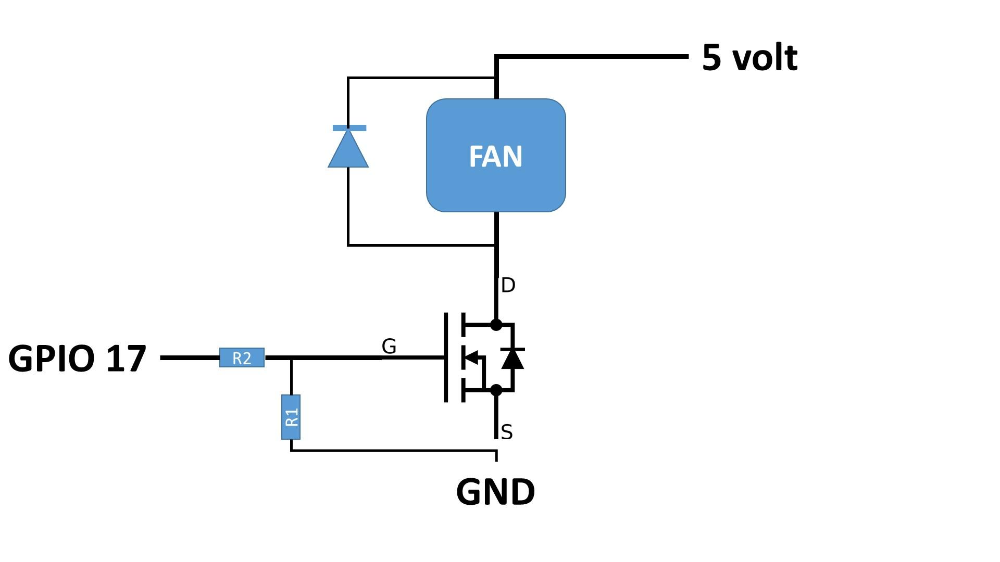

# pi-fan-controller

Raspberry PiのCPU温度に基づき外部接続したFanのOn/Offを制御する。

## Usage
pi-fan-controller Low_Limit_Temperature High_Limit_Temperature BCM_Number

Low_Limit_Temperature : CPU温度が当該温度を下回った場合にFanをOffにする
High_Limit_Temperature :  : CPU温度が当該温度を上回った場合にFanをOnにする
BCM_Number : FanのOn/Off制御の制御ラインが接続されているGPIOピン

## Hardware for Fan controlling

Raspberry PiのGPIOでは外部ファンを直接駆動することは出来ない。この為、ファンのOn/Offを制御するスイッチング回路を制御することでファンのOn/Offを制御する。
以下に制御回路の一例を示す。
<p align="center">

</p>
R1 : 10kΩ<br>
R2 : 100Ω<br>
Diode : 1S4<br>
MOSFET : 2SK4017(Q)<br>

## Installation

### Reqirements

Required:

GPIO access library, [WiringPi](https://github.com/WiringPi/WiringPi/tree/master)<br>

### Installation on ubuntu 24

``` bash
git clone https://github.com/yfurukawa/pi-fan-controller.git
cd pi-fan-controller
make
make install
```
